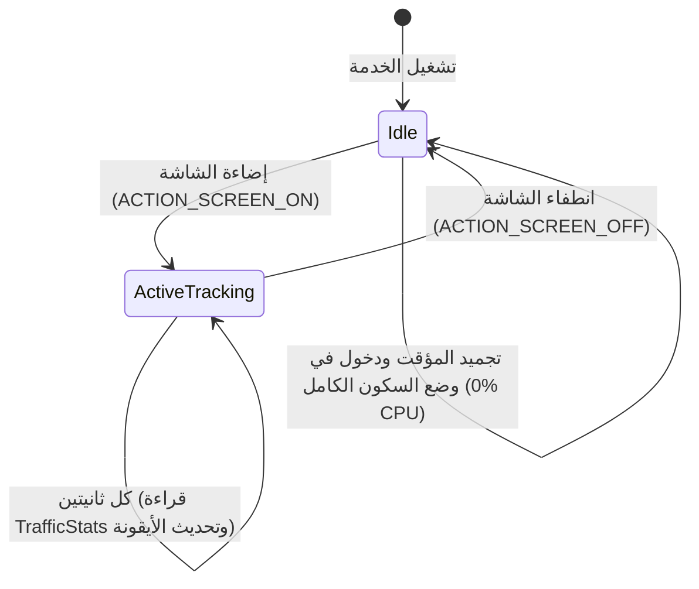

# SpeedMeterHeadless ⚡

تطبيق أندرويد مصغر وخفيف للغاية بلغة **Kotlin**، يعمل بنمط **Headless** (بدون أي واجهة مستخدم أو أيقونة في درج التطبيقات)، ومخصص لعرض سرعة الإنترنت الحقيقية واللحظية مباشرة في **شريط الحالة (Status Bar)** بجانب الساعة عبر أيقونة نصية ديناميكية فائقة الوضوح.

تم تصميمه واختباره وتوافقه بالكامل مع **Android 16** وواجهة **Samsung One UI**.

---

## 🌟 المميزات الرئيسية (Key Features)

- **بدون واجهة أو أيقونة مشتتة (100% Headless):**
  لا يحتوي على أي `Activity` أو أيقونة في قائمة التطبيقات، ويعمل بالكامل كخدمة نظام أمامية خفيفة (`Foreground Service`).
- **أيقونة نصية ديناميكية فائقة الوضوح (Ultra-Bold Dynamic Icon):**
  توليد أرقام السرعة والوحدة (`K`, `M`, `G`) لحظياً على Bitmap عالي التباين بدقة 96×96 مع استخدام تقنية `FILL_AND_STROKE` والخط المضغوط `sans-serif-condensed` لضمان قراءة سريعة ومريحة بالعين عن بُعد تناسب خط ساعة الهاتف.
- **استهلاك صفر للبطارية عند قفل الشاشة (Zero Battery Drain):**
  مراقبة ذكية لحالة الشاشة (`ACTION_SCREEN_OFF` و `ACTION_SCREEN_ON`)؛ تتجمد الخدمة ويتوقف المؤقت تماماً عند انطفاء الشاشة لتوفير 100% من طاقة المعالج، وتستأنف بسلاسة فور إضاءتها مع حساب خط أساس جديد لمنع القفزات الوهمية.
- **حصانة واستقرار دائم 24/7 (Immune to Kills & Sleep):**
  - تصنيف أولوية ذاكرة عالي في النواة: `oom_score_adj = 200` (`PERCEPTIBLE_APP / FOREGROUND_SERVICE`).
  - معفى بالكامل من وضع الاستعداد وقيود إدارة الطاقة لسامسونج (`STANDBY_BUCKET_EXEMPTED` - تصنيف 5).
  - يدعم `START_STICKY` لإعادة التشغيل الذاتي في حالة ندرة الذاكرة.
  - تشغيل تلقائي فور إعادة تشغيل الهاتف عبر `BootReceiver` المتوافق مع أندرويد 16.
- **إشعار نظام راقٍ ومتوافق مع الوضع الليلي (Dark Theme Adaptive):**
  تصميم أيقونة Adaptive دائرية داكنة جرافيتية (`#1E2024`) مع مؤشر أزرق سماوي ناعم (`#38BDF8`) تحل محل المربعات البيضاء المزعجة، مع عرض أنيق ومنظم لسرعتي التحميل والرفع وحجم البيانات في الجلسة بدون إيموجيات مشتتة.
- **استهلاك موارد لا يُذكر (Ultra-low Footprint):**
  - استهلاك الذاكرة: ~**2.9 ميغابايت** فقط (Dalvik Heap).
  - استهلاك المعالج: **0.0%** (أقل من 0.7 ميلي ثانية كل ثانيتين).
  - عدد الواجهات المفتوحة: `0 Views` و `0 Activities`.

---

## 🏗️ هيكلية المشروع (Architecture)

```
D:\GitHub\SpeedMeterHeadless\
├── app/
│   ├── build.gradle
│   └── src/main/
│       ├── AndroidManifest.xml
│       ├── java/com/speedmeter/headless/
│       │   ├── SpeedService.kt           # إدارة الخدمة الأمامية ودورة حياة الشاشة
│       │   ├── SpeedBitmapGenerator.kt   # توليد الأيقونة النصية والرسومات اللحظية
│       │   └── BootReceiver.kt           # إعادة التشغيل التلقائي عند إقلاع الجهاز
│       └── res/
│           ├── drawable/
│           │   ├── ic_launcher_background.xml
│           │   ├── ic_launcher_foreground.xml
│           │   └── ic_speed.xml
│           ├── mipmap-anydpi-v26/
│           │   └── ic_launcher.xml       # أيقونة التكيف الداكنة للوحة الإشعارات
│           └── values/
│               ├── colors.xml
│               └── strings.xml
├── build.gradle
├── gradle.properties
├── local.properties
└── settings.gradle
```

---

## 🔄 مخطط دورة حياة الحفاظ على الطاقة (Lifecycle Flow)



---

## 🚀 طريقة البناء والتثبيت (Build & Install)

### 1. المتطلبات الأساسية
- حزمة تطوير أندرويد (Android SDK) مع `compileSdk 35` أو `36`.
- بيئة تشغيل Java JDK 17 أو 21.
- تفعيل خيارات المطور وتصحيح أخطاء USB (`USB Debugging`) على الهاتف وتوصيله عبر ADB.

### 2. البناء (Build)
افتح الطرفية (Terminal / PowerShell) في مجلد المشروع ونفّذ:
```powershell
./gradlew assembleDebug
```
سيتم إنتاج ملف الـ APK في:
`app/build/outputs/apk/debug/app-debug.apk`

### 3. التثبيت والتهيئة عبر ADB
قم بتنفيذ الأوامر التالية بالترتيب لتثبيت التطبيق وتفعيله فوراً:

```powershell
# 1. تثبيت التطبيق على الهاتف المتصل
adb install -r app/build/outputs/apk/debug/app-debug.apk

# 2. منح صلاحية إرسال الإشعارات
adb shell pm grant com.speedmeter.headless android.permission.POST_NOTIFICATIONS

# 3. استثناء التطبيق من قيود توفير الطاقة (Doze Mode Whitelist)
adb shell dumpsys deviceidle whitelist +com.speedmeter.headless

# 4. السماح بالعمل في الخلفية بشكل مطلق
adb shell cmd appops set com.speedmeter.headless RUN_IN_BACKGROUND allow
adb shell cmd appops set com.speedmeter.headless START_FOREGROUND allow

# 5. تشغيل الخدمة فوراً في شريط الحالة
adb shell am start-foreground-service -n com.speedmeter.headless/.SpeedService
```

---

## 🛠️ أوامر التحكم والفحص عبر ADB (ADB Cheatsheet)

| الإجراء | الأمر عبر ADB |
| :--- | :--- |
| **إيقاف الخدمة** | `adb shell am stopservice -n com.speedmeter.headless/.SpeedService` |
| **تشغيل الخدمة** | `adb shell am start-foreground-service -n com.speedmeter.headless/.SpeedService` |
| **إعادة تشغيل نظيفة** | `adb shell am stopservice -n com.speedmeter.headless/.SpeedService; adb shell am start-foreground-service -n com.speedmeter.headless/.SpeedService` |
| **فحص القراءة اللحظية** | `adb shell "dumpsys notification --noredact \| grep -A 2 'android.title=String (↓'"` |
| **فحص أولوية الذاكرة (LMK)** | `adb shell 'cat /proc/$(pidof com.speedmeter.headless)/oom_score_adj'` *(النتيجة: 200)* |
| **فحص استهلاك المعالج** | `adb shell "top -b -n 1 \| grep com.speedmeter.headless"` *(النتيجة: 0.0%)* |
| **فحص استهلاك الذاكرة** | `adb shell dumpsys meminfo com.speedmeter.headless` *(النتيجة: ~2.9 MB)* |
| **إلغاء التثبيت بالكامل** | `adb uninstall com.speedmeter.headless` |

---

## ⚙️ التفاصيل التقنية للأجهزة الحديثة (Android 14 / 15 / 16)

- **Foreground Service Type:**
  تم تعيين النوع كـ `specialUse` وفق معايير أندرويد الحديثة مع تضمين الخاصية الإلزامية:
  ```xml
  <property
      android:name="android.app.PROPERTY_SPECIAL_USE_FGS_SUBTYPE"
      android:value="Real-time internet speed indicator in status bar" />
  ```
- **سلوك الظهور الفوري:**
  تم تفعيل `Notification.FOREGROUND_SERVICE_IMMEDIATE` لمنع التأخير الافتراضي (10 ثوانٍ) في نظام أندرويد 12 فما فوق ليظهر الإشعار والأيقونة بشكل فوري ومستمر.
- **التسجيل الديناميكي للمستقبلات:**
  يتم تسجيل مستمعي حالة الشاشة برمجياً مع علم `Context.RECEIVER_EXPORTED` للامتثال لمتطلبات الأمان في Android 14+.

---

## 📄 الترخيص (License)
هذا المشروع مفتوح المصدر ومتاح للاستخدام والتعديل الشخصي والتطوير الحر.
